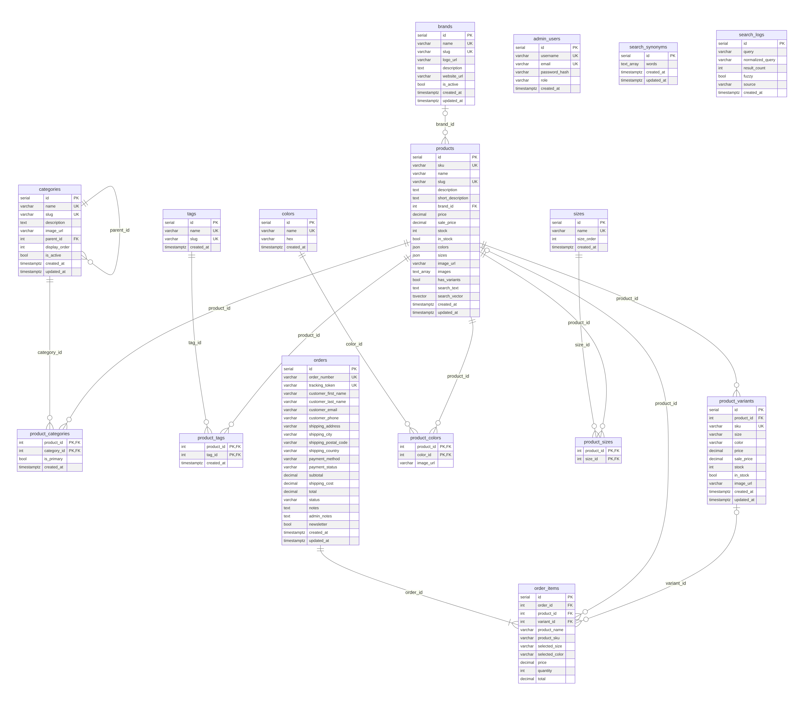
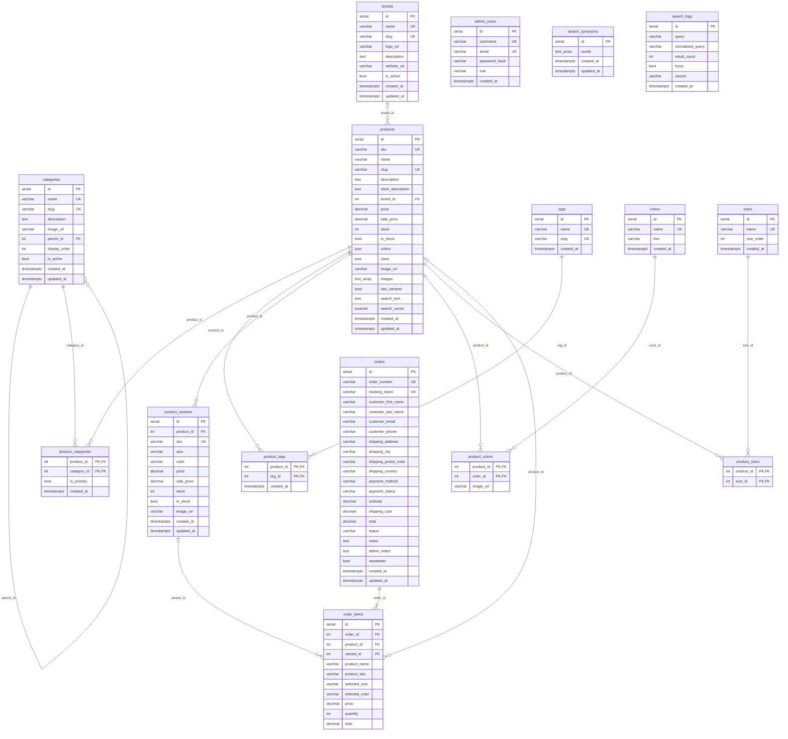

# Hidron Database

PostgreSQL database behind **Hidron**, an online shop for swimming equipment (swimwear, goggles, training gear). It holds the product catalog, guest checkout orders, the admin accounts and the storefront search.

The schema is defined with Drizzle ORM in the Hidron backend and built up by 9 migrations. [`schema.sql`](schema.sql) is the resulting schema, dumped from a database with all migrations applied. It recreates every table, constraint, index, function and trigger on an empty database.

| | |
|---|---|
| Engine | PostgreSQL 13+ |
| Tables | 16 |
| Triggers | 14 (URL slugs and search index) |
| Extensions | `pg_trgm` (typo-tolerant search), `unaccent` (accent-insensitive search) |

## In this folder

| File | What it is |
|---|---|
| [`schema.sql`](schema.sql) | Full DDL: tables, constraints, indexes, functions, triggers |
| [`QUERIES.md`](QUERIES.md) | How the complex queries work, and why they're written that way |
| [`INDEXES.md`](INDEXES.md) | Every index, the query it serves, and which ones current queries don't use |
| [`CACHING.md`](CACHING.md) | The caching layers from database to browser, and why |
| [`images/er-diagram.png`](images/er-diagram.png) | ER diagram as an image, for slides and documents |

## Entity relationship diagram



<details>
<summary>Same diagram as Mermaid source</summary>



</details>

`admin_users`, `search_synonyms` and `search_logs` have no foreign keys.

## Tables

### Catalog

| Table | Purpose | Notable rules |
|---|---|---|
| `products` | The items for sale. One brand, many categories, tags, colours, sizes and variants. | `price > 0`; `sale_price` is null or between 0 and `price`; `stock >= 0`; unique `sku` and `slug` |
| `product_variants` | Size/colour variants with their own SKU, price and stock. | Same price and stock checks as `products`; deleted with their product |
| `categories` | Category tree, nested through `parent_id`. | A category with subcategories cannot be deleted (`ON DELETE RESTRICT`) |
| `brands` | Product brands. | Deleting a brand keeps its products and clears `brand_id` |
| `tags` | Free-form product labels. | |
| `colors` | Colour list with hex code. | `hex` must match `^#[0-9A-Fa-f]{6}$` |
| `sizes` | Size list with a sort order (`size_order`). | |

### Link tables (many-to-many)

| Table | Links | Notable rules |
|---|---|---|
| `product_categories` | products ↔ categories | Composite PK; at most one `is_primary` category per product (partial unique index) |
| `product_tags` | products ↔ tags | Composite PK |
| `product_colors` | products ↔ colors | Composite PK; optional colour-specific image |
| `product_sizes` | products ↔ sizes | Composite PK |

All link rows are deleted with either side (`ON DELETE CASCADE`).

### Orders

| Table | Purpose | Notable rules |
|---|---|---|
| `orders` | Guest checkout orders. Customer and shipping details live on the order, so there is no customer table. | `status` ∈ pending, confirmed, processing, shipped, delivered, cancelled, refunded; `payment_status` ∈ pending, paid, failed, refunded; `total = subtotal + shipping_cost`; random 64-character `tracking_token` for tracking links |
| `order_items` | Order lines. Product name, SKU and price are copied at purchase time, so past orders don't change when the catalog does. | `quantity > 0`; `total = price × quantity`; a product that appears in an order cannot be deleted; a deleted variant clears `variant_id` |

### Admin and search

| Table | Purpose |
|---|---|
| `admin_users` | Back-office accounts (unique username and email, password hash, role). |
| `search_synonyms` | Groups of interchangeable search words, e.g. *naocale* / *goggles*. GIN-indexed. |
| `search_logs` | One row per storefront search: query, result count, whether fuzzy matching was used. |

## Logic in the database

**Product URL slugs.** The `products_slug_fill` trigger runs before insert, and before an update of `slug`. When `slug` is empty it builds one from the name: *Arena Cobra Ultra Swipe naočale* becomes `arena-cobra-ultra-swipe-naocale`. If that slug is taken it appends the product id. Renaming a product keeps its slug, so links and search results don't break.

**Full-text search index.** `refresh_product_search(ids)` rebuilds two columns on `products`:

- `search_vector` (`tsvector`, GIN index), weighted A = name, B = brand and categories, C = tags and SKUs (including variant SKUs), D = descriptions with HTML removed.
- `search_text`, a lowercase, accent-free copy of the key fields with a trigram GIN index, used for typo-tolerant matching.

Triggers call it whenever something that feeds the index changes:

| Trigger on | Fires when |
|---|---|
| `products` | name, SKU, descriptions or brand change (per row) |
| `product_categories`, `product_tags`, `product_variants` | rows are inserted, updated or deleted (once per statement, using transition tables) |
| `brands`, `categories`, `tags` | the name changes, re-indexing every product that uses it |

Helper functions: `search_normalize(text)` (lowercase, strip accents), `search_strip_html(text)`, `slugify(text)`.

## How the complex queries work

See [`QUERIES.md`](QUERIES.md) for checkout stock locking, faceted filter counts, ranked typo-tolerant search, the search index triggers and the search analytics report.

## Indexes

60 in total: 16 primary keys, 15 unique constraints and 29 other indexes (B-tree, full-text GIN, trigram GIN, a partial unique and an expression unique index). Every foreign key column is indexed. See [`INDEXES.md`](INDEXES.md) for each index and why it exists, including three queries that currently read the whole table instead of using their index, and three indexes that may be unused.

## Caching

Precomputed search columns in the database, a 60-second API response cache in server memory, HTTP cache headers, prerendered pages and a browser-side data cache. Checkout never uses cached data. See [`CACHING.md`](CACHING.md).

## Load the schema

```bash
createdb hidron
psql -d hidron -f hidron-database/schema.sql
```

To try it out:

```sql
INSERT INTO brands (name, slug) VALUES ('Arena', 'arena');
INSERT INTO products (sku, name, price, brand_id)
VALUES ('X1', 'Arena Cobra Ultra Swipe naočale', 59.90, 1);

SELECT slug, search_text FROM products;
-- arena-cobra-ultra-swipe-naocale | arena cobra ultra swipe naocale arena x1
```
